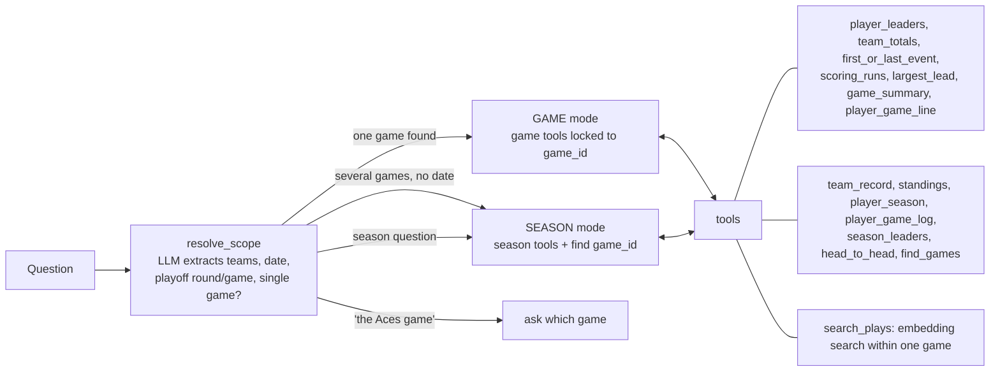

# WNBA Agentic RAG


Ask anything about the 2025 WNBA season the way a fan would type it, and get an answer
grounded in the data, along with every tool call behind it:

> *who went off for the lynx in the 4th vs golden state on sept 11?*
> *How did Caitlin Clark do against the Sky this year?*
> *In A'ja Wilson's best scoring game, who led the other team in points?*
> *Who scored the most points in Game 3 of the Finals?*

A LangGraph agent first decides the **scope** of the question: one game, or the season.
It sends **counting** questions to exact statistics tools that are checked against
official box scores, and **descriptive** questions to retrieval limited to that one game.
When the question can't be pinned down, it asks; when the data doesn't cover it, it
declines.

## Results

All systems use `gpt-4o-mini`. Grading is deterministic: no LLM judge for these numbers.

### Held-out test: natural-language questions (v2)

140 questions about teams and players never used during development: casual rewrites
of single-game questions, season questions, multi-step questions, and questions the
system should **not** answer. The agent was run three times to measure run-to-run
variation.

| System | Accuracy | Avg cost / question |
|---|---:|---:|
| LLM only | 5.7% | $0.00004 |
| Naive RAG (top-k search over all games) | 18.6% | $0.00038 |
| Scoped RAG (right game, search only) | 20.0% | $0.00064 |
| **Agentic (scope + stats tools + scoped search)** | **96.2%** (96.4 / 96.4 / 95.7 over 3 runs) | $0.00073 |

| Category | n | Naive RAG | Agentic (run 1) |
|---|---:|---:|---:|
| Casual single-game questions | 60 | 17% | 97% |
| Season questions (records, leaders, averages, head-to-head, playoffs) | 46 | 4% | 100% |
| Multi-step questions | 12 | 0% | 83% |
| Should ask or decline (ambiguous, other seasons/leagues, nonexistent games) | 22 | 64% | 95% |

Full breakdown: [`eval/results_v2_test/summary.md`](eval/results_v2_test/summary.md).

### Held-out test: templated single-game questions (v1)

266 questions over 30 games not used during development.

| System | Accuracy |
|---|---:|
| LLM only | 0.0% |
| Naive RAG | 23.7% |
| Scoped RAG | 38.0% |
| **Agentic** | **99.2%** (264/266) |

### Descriptive answers: fact-checked claim by claim

45 "how did they win / what happened in the 4th / describe her game" questions over 15
games. Each answer is split into individual claims, and each claim is checked against the
game's **full** play-by-play and box score by an LLM judge. The judge was first validated
on 120 planted claims (half true, half with one detail changed): 95% accuracy, and it
**never marked a false claim as supported** ([`judge_validation.json`](eval/results_faithfulness/judge_validation.json)).

| System | Claims | Supported | Contradicted | Answers with ≥1 false claim |
|---|---:|---:|---:|---:|
| Naive RAG | 236 | 68.2% | 27.5% | 71% |
| Scoped RAG | 386 | 77.2% | 18.9% | 78% |
| **Agentic** | 465 | **83.7%** | **14.8%** | 64% |

**This is the weakest part of the system.** The agent is the most accurate and gives the
most detail (10 claims per answer), but about 1 in 7 of its descriptive claims is wrong.
The judge's evidence shows most errors are arithmetic or summarizing the model does on
its own: adding quarter scores, or describing a run from the tool output. Part of the
14.8% is judge error, since it rejected 5 of 60 true claims in validation. Next steps:
tools that return half and period aggregates directly, and a post-answer check that
every number in the reply appears in a tool result.

### What the comparisons show

1. **Retrieval without knowing the game mostly fails.** The data covers 312 games, and
   embedding search for "the first three of the Aces at Fever game" returns plays from
   other Aces or Fever games.
2. **Knowing the game helps, but retrieval still cannot count.** Scoped RAG finds the
   right game, but "most points in the 4th" needs every play in the quarter, not the
   five most similar chunks. Season questions are out of reach for retrieval entirely.
3. **Routing to deterministic tools fixes that.** The model chooses the tool and its
   arguments, and pandas does the arithmetic. The remaining errors are mostly tool-choice
   and interpretation mistakes, listed below.

## How it works



* **Scope resolution** ([`agent.py`](wnba_rag/agent.py), [`games.py`](wnba_rag/games.py)):
  the LLM extracts a structured reference. Deterministic code then validates it. Team
  names are resolved on whole words, so "lib", "valks", "the suns" and "LV" all work, but
  a player's name is never taken for a team. A date the question doesn't contain is
  dropped. If one game matches, the game tools are locked to it, so the model cannot
  query the wrong game.
* **Stats tools** ([`stats.py`](wnba_rag/stats.py), [`season.py`](wnba_rag/season.py)):
  per-game counting from every play, plus season records, standings, leaders,
  head-to-head and game logs from the box scores. The All-Star Game and the
  Commissioner's Cup final are excluded from season stats, as in official WNBA stats,
  and playoff rounds and game numbers are derived from the schedule.
* **Game-scoped retrieval** ([`retrieval.py`](wnba_rag/retrieval.py)): chunks of 12
  consecutive plays from one game, each line carrying quarter, clock, team and running
  score. They are embedded once (`text-embedding-3-small`, 10,689 chunks, local FAISS).
  For "how did they win?" questions, the agent first locates *when* things happened with
  the stats tools, then retrieves those quarters and cites chunk ids.
* **Cost tracking**: every answer reports LLM calls, tokens and cost, about $0.0007 per
  question, or $0.70 per 1,000.

## Data

ESPN's public game summaries for all **312 games of the 2025 season**: 286 regular
season, 24 playoff, plus the All-Star Game and the Commissioner's Cup final. They
provide team, running score and player ids on every play (121,342 plays), official box
scores and quarter scores. See [`scripts/fetch_espn.py`](scripts/fetch_espn.py) and
[`build_tables.py`](wnba_rag/build_tables.py).

## Validation

**Stats tools vs. official box scores**, all 5,916 player-games
([`tests/test_stats.py`](tests/test_stats.py)):

| Points | Threes | Rebounds | Assists | Steals | Blocks | Turnovers | Fouls |
|---|---|---|---|---|---|---|---|
| 100% | 100% | 99.95% | 99.90% | 99.92% | 99.97% | 99.76% | 99.85% |

Season tools reproduce known 2025 results: Lynx 34–10, A'ja Wilson's 23.4 ppg scoring
title, the Aces' 4–0 Finals sweep ([`tests/test_season.py`](tests/test_season.py)).
25 tests run in CI with no API key.

**Data traps found along the way**, each now covered by a test:

* ESPN logs **traveling** as its own play type, without "Turnover" in the name.
  Turnover counts matched the box score only 92% of the time before this was fixed.
* **2.7% of made threes** are written like "25-foot running pullup jump shot", with no
  "three point" in the text. Threes are now identified by points scored.
* Players who **changed names** mid-season (Nia Coffey → Nia Brodie) are matched by id.
* ESPN's row order and game clock disagree 821 times across 263 games. Ordering by
  clock instead would change only 7 of ~1,250 first/last lookups.
* A team-resolver bug: All-Star rosters have no nickname, so an **empty-string alias
  matched every name**, and "Kelsey Mitchell" resolved to "TEAM COLLIER". Found by the
  v2 dev set.

## Evaluation design

* **Dev/test splits.** Every change in the code was driven by dev-set failures. Test
  sets were run only after the code was frozen. v1 splits by game; v2 splits by **team**
  (5 dev teams, 8 test teams), so test questions involve teams and players never seen
  while building.
* **Answer keys come from independent code paths**: official box scores and final or
  quarter scores, or play text parsed separately from the fields the tools use (the two
  parsers agree on 99.6% of player point totals). Disagreements are kept, so answer-key
  noise counts against the agent.
* **Grading** ([`eval/grade.py`](eval/grade.py)) reads only the `FINAL ANSWER:` line. Naming
  an extra player to hedge fails. Decimals must match within 0.05. "Should not answer"
  items pass only if the reply asks or declines without inventing a stat.
* **Casual rewrites** were produced by an LLM and checked in code for kept teams, players
  and dates. Every rewrite was then read by hand, and 10 of 172 whose meaning had changed
  (e.g. "…and by how many?" turning a points question into a margin question) were
  reverted ([`eval/v2_rewrite_review.json`](eval/v2_rewrite_review.json)).

### Known failure modes (from the held-out runs)

* **Descriptive answers contain errors**: 14.8% of claims contradicted (see above).

* **Tool choice on slang**: "who *dropped the final points*" was once answered with fuzzy
  search instead of the exact `first_or_last_event` tool, and got the wrong free throws.
  A fix would be routing hints or few-shot examples for "first/last" phrasing.
* **Missing tool**: "the Storm's highest-scoring game" needs a team game log, which
  doesn't exist yet. Multi-step questions of that shape scored 1/3.
* **Wrong refusal type**: "LeBron James in the 2025 NBA Finals" got "which game?" instead
  of "this data is WNBA only". It was safe, with no invented number, but the wrong behavior.
* **Ambiguous phrasing**: "the first 3 *of the suns* at aces game" was read as the Sun's
  first three. That's a defensible reading of a rewrite I missed during review.

### Limitations

* The key used for development could only access `gpt-4o-mini`, so the casual rewrites
  come from the same model family as the agent and may be easier for it than human
  phrasing. A small set of human-written questions would be the stronger test.
* Season and multi-step questions are generated from templates, then rewritten.
* One season. Answers are only as good as ESPN's play logging.

## Run it

```bash
python -m venv .venv && source .venv/bin/activate
pip install -r requirements.txt
cp .env.example .env                 # add OPENAI_API_KEY
python scripts/fetch_espn.py         # ~3 min, cached in data/raw/ (processed tables are committed)
python -m wnba_rag.build_tables
python -m wnba_rag.retrieval build   # one-time embedding, about $0.10
pytest -q

python -m app.cli "How did Caitlin Clark do against the Sky this year?"
streamlit run app/streamlit_app.py
```

Evaluation (resumable):

```bash
python -m eval.run_eval --bench v2 --split test
python -m eval.run_eval --bench v1 --split test
python -m eval.faithfulness --validate-judge
python -m eval.faithfulness --games 15
```

Docker: `docker build -t wnba-agentic-rag . && docker run --env-file .env -v "$PWD/data:/app/data" -p 8501:8501 wnba-agentic-rag`

## Project history

This started as the final project for Northwestern MLDS Generative AI (Winter 2026),
which compared a base LLM, basic RAG and a LangGraph agent on ten hand-written questions
about "the game". This version is a rebuild of that project:

* Each question is now tied to a specific game. The original indexed 312 games without
  doing this, so retrieved plays came from many games.
* Counting and season questions use deterministic tools instead of top-k retrieval.
* Graded benchmarks with held-out splits replace the qualitative comparison.
* The original described the agent as LoRA-enhanced, but its graph never called the LoRA
  model. The LoRA fine-tuning experiment was a separate assignment and is not part of
  this system.
